# Gravitational N-body Problem in Python: Symplectic Integrators, Chaos and Celestial Mechanics

[](https://www.python.org/)
[](LICENSE)
[](https://github.com/jesus-garcia-izquierdo/N-body-problem/actions/workflows/tests.yml)
[](https://colab.research.google.com/github/jesus-garcia-izquierdo/N-body-problem/blob/main/notebooks/N_body_quickstart.ipynb)
<br>
[](https://github.com/topics/n-body)
[](https://github.com/topics/celestial-mechanics)
[](https://github.com/topics/symplectic-integrator)
[](https://github.com/topics/chaos-theory)
[](https://github.com/topics/computational-physics)

**Autor:** [Jesús García Izquierdo](https://github.com/jesus-garcia-izquierdo) | Físico e Investigador (M.Sc. student in Condensed Matter Physics).

---

## The Physical Problem

<p align="center">
  <a href="https://github.com/jesus-garcia-izquierdo/N-body-problem/raw/main/videos/figure_eight.mp4">
    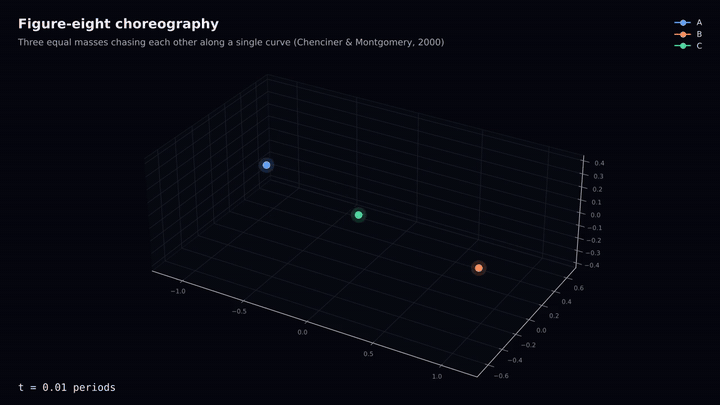
  </a>
</p>
<p align="center"><em>Figure-eight choreography of three equal masses (Chenciner &amp; Montgomery, 2000), integrated with velocity Verlet. Click the animation to open the full-quality MP4.</em></p>

$N$ point masses interact only through Newtonian gravity:

$$
\ddot{\mathbf r}_i = G\sum_{j\neq i} m_j\,\frac{\mathbf r_j-\mathbf r_i}{|\mathbf r_j-\mathbf r_i|^{3}}, \qquad i = 1,\dots,N .
$$

For $N=2$ the motion is a conic (Kepler). For $N\ge 3$ there is no general closed-form solution:
Bruns (1887) proved that no algebraic integrals exist beyond the ten classical ones, and Poincaré (1890)
discovered that the motion can be exponentially sensitive to the initial conditions, the birth of **chaos
theory**. The only general route is numerical integration, and a numerical solution is only trustworthy if
it respects what the exact dynamics guarantees:

* **Hamiltonian structure.** $H=\sum_i |\mathbf p_i|^2/2m_i - \sum_{i<j} G m_i m_j/r_{ij}$ is separable, so the
  flow can be split into exact "drift" and "kick" maps. Their symmetric composition is the **velocity Verlet**
  method: second order, time-reversible and **symplectic**. It solves exactly a *shadow Hamiltonian*
  $\tilde H = H + \mathcal O(h^2)$, so the energy error stays bounded over arbitrarily many orbits.
* **Conservation laws (Noether).** Linear momentum $\mathbf P$, angular momentum $\mathbf L$ and energy $E=K+U$.
* **Virial theorem.** For a bound system in the centre-of-mass frame, $2\langle K\rangle = -\langle U\rangle$.
* **Stability and chaos.** Linear stability of exact solutions (Lagrange's triangle, Routh's criterion) and the
  maximal **Lyapunov exponent** $\lambda$, which sets the prediction horizon $t_\text{pred}\approx\lambda^{-1}\ln(\Delta/\delta_0)$.

This repository implements all of the above in a fully vectorized NumPy package (`nbody/`), validates every
result against theory, and documents the physics from first principles. It extends and corrects a 2023 MATLAB
course project (see [docs/FROM_MATLAB.md](docs/FROM_MATLAB.md)).

## Models and Results

| Script | Physical concept | Key result (simulation vs. theory) |
|---|---|---|
| [`01_sun_earth_moon.py`](examples/01_sun_earth_moon.py) | Conservation laws, virial theorem, centre-of-mass frame, solar perturbation of the lunar orbit | $\lvert\Delta E/E_0\rvert = 6.4\times10^{-10}$ over 2 years; $2\langle K\rangle/(-\langle U\rangle) = 1.00002$ |
| [`02_four_body.py`](examples/02_four_body.py) | Kepler problem around a $10^{10}\,M_\odot$ body, vis-viva equation | eccentricity $0.5000$ vs. $0.5$ predicted |
| [`03_chaos_six_body.py`](examples/03_chaos_six_body.py) | Sensitivity to initial conditions, Lyapunov exponent (Benettin), shadowing | Lyapunov time $\approx 108$ days; even $h$ vs. $h/2$ diverges exponentially |
| [`04_figure_eight.py`](examples/04_figure_eight.py) | Periodic choreography, KAM stability | returns to its initial state within $3\times10^{-6}$ after one period |
| [`05_lagrange_stability.py`](examples/05_lagrange_stability.py) | Lagrange equilateral solution, linear stability, Routh's criterion | growth rate $\sigma = 1.225$ vs. $\omega/\sqrt2 = 1.225$ |
| [`06_compare_integrators.py`](examples/06_compare_integrators.py) | Order of convergence vs. symplectic structure (Euler, symplectic Euler, Verlet, Yoshida-4, RK4) | measured orders $0.93,\ 0.99,\ 2.00,\ 4.00,\ 4.13$ vs. $1,1,2,4,4$ |
| [`07_solar_system.py`](examples/07_solar_system.py) | Sun + 8 planets with real orbital elements, Kepler's third law | slope of $\log T$ vs. $\log a$ $= 1.499$ vs. $3/2$ |
| [`08_cluster_virial.py`](examples/08_cluster_virial.py) | Plummer sphere, cold collapse, violent relaxation | virial ratio $Q: 0 \to 1.03$ within a few free-fall times |

### 3D videos

Every example renders a 3D MP4 (1280×720, H.264) with a rotating camera and fading trails. The animations
below are previews of those videos; **click any of them to open the full-quality MP4**.

| | |
|:---:|:---:|
| <a href="https://github.com/jesus-garcia-izquierdo/N-body-problem/raw/main/videos/six_body_chaos.mp4">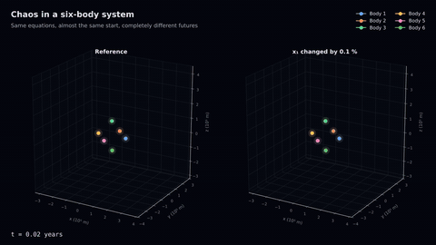</a><br>**Chaos.** Right panel: $x_1$ changed by 0.1 %. | <a href="https://github.com/jesus-garcia-izquierdo/N-body-problem/raw/main/videos/euler_vs_verlet.mp4">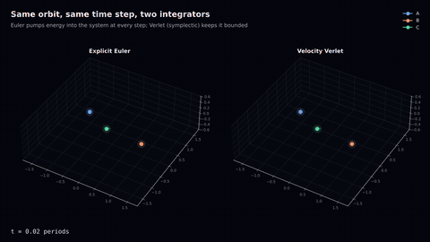</a><br>**Euler vs. Verlet.** Same orbit, same step: Euler pumps in energy. |
| <a href="https://github.com/jesus-garcia-izquierdo/N-body-problem/raw/main/videos/solar_system_outer.mp4">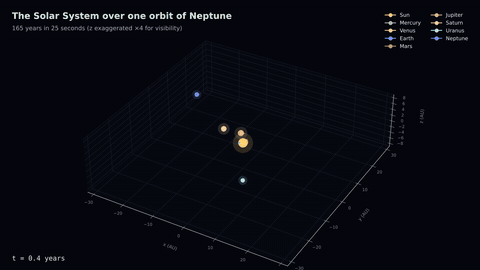</a><br>**The Solar System** over one orbit of Neptune (165 years). | <a href="https://github.com/jesus-garcia-izquierdo/N-body-problem/raw/main/videos/solar_system_inner.mp4">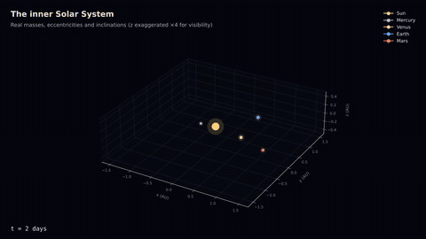</a><br>**The inner planets** with real eccentricities and inclinations. |
| <a href="https://github.com/jesus-garcia-izquierdo/N-body-problem/raw/main/videos/lagrange_unstable.mp4">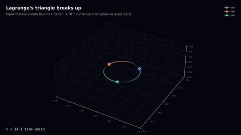</a><br>**Lagrange's triangle breaks up**: equal masses violate Routh's criterion. | <a href="https://github.com/jesus-garcia-izquierdo/N-body-problem/raw/main/videos/cold_collapse.mp4">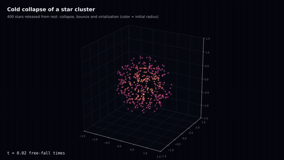</a><br>**Cold collapse** of 400 stars: collapse, bounce and virialization. |
| <a href="https://github.com/jesus-garcia-izquierdo/N-body-problem/raw/main/videos/four_body.mp4">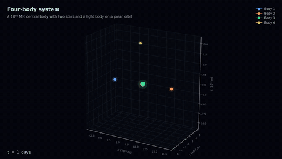</a><br>**Four bodies** around a $10^{10}\,M_\odot$ central body. | |

### Selected figures

| | |
|:---:|:---:|
| 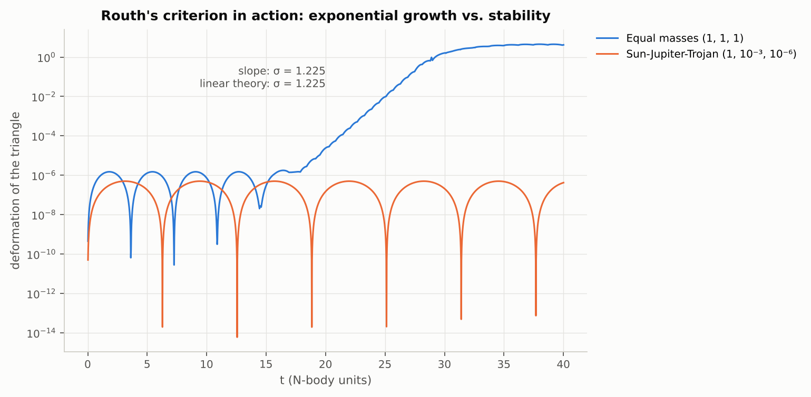<br>Exponential instability of the equal-mass Lagrange triangle at the rate of linear theory. | 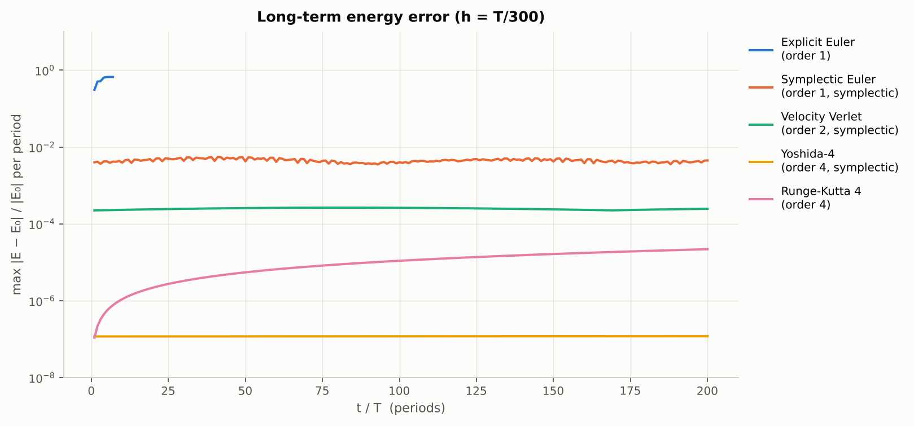<br>Long-term energy error: only the non-symplectic methods drift. |
| 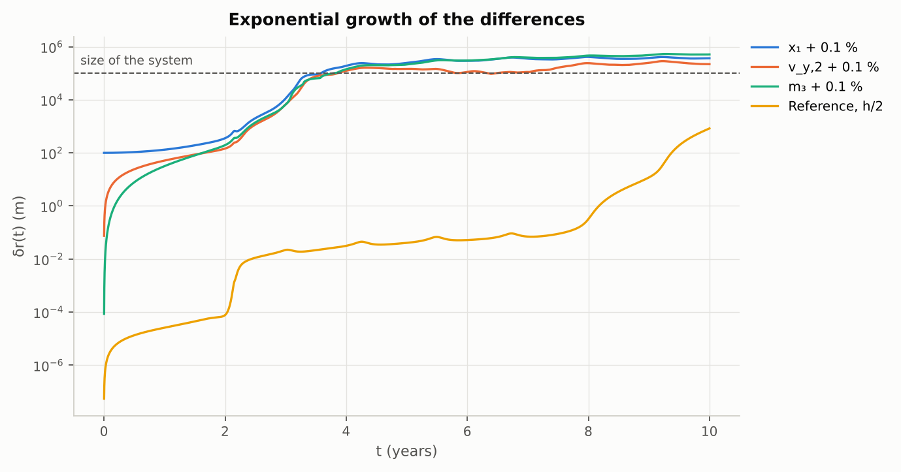<br>Exponential divergence of nearby trajectories in the six-body system. | 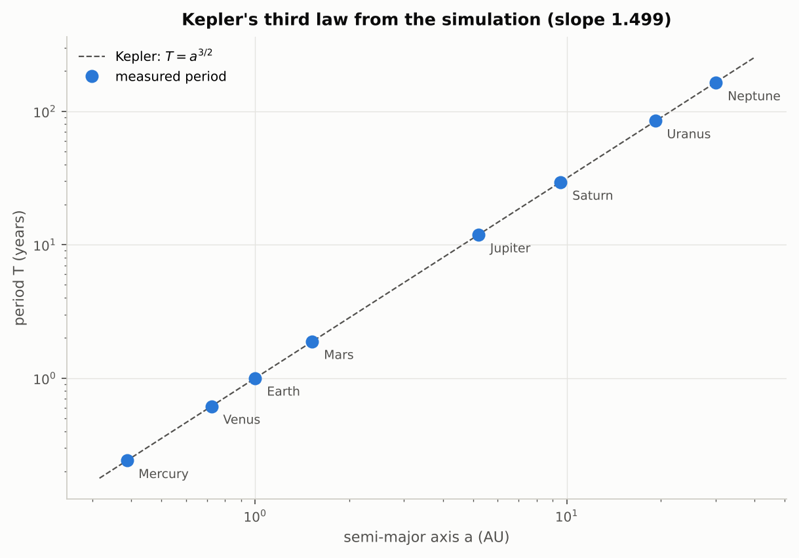<br>Kepler's third law measured in the simulation. |

### Validation

The test suite (`pytest`) checks the physics: Newton's third law ($\sum_i m_i\mathbf a_i = 0$), $m_i\mathbf a_i=-\nabla_i U$
by finite differences (with and without softening), the theoretical order of every integrator, time
reversibility of Verlet ($<10^{-10}$), conservation of $\mathbf P$ and $\mathbf L$ to machine precision, bounded
vs. drifting energy, the virial theorem, Kepler's circular orbit and the Lagrange growth rate.

<!-- ESPACIO PARA GIF/IMAGEN: GitHub only plays videos uploaded through its web editor. To show an inline
     video player here: edit README.md on github.com, drag videos/figure_eight.mp4 (or any other MP4) into
     the editor, and leave the generated https://github.com/user-attachments/assets/... link alone on a line
     at this position. The animated previews above already work without this step. -->

## Quick Start

**Requirements:** Python ≥ 3.9, NumPy, Matplotlib. The 3D videos also need [ffmpeg](https://ffmpeg.org)
(`conda install ffmpeg`, `brew install ffmpeg` or `sudo apt install ffmpeg`).
No installation at all: [open the quick-start notebook in Google Colab](https://colab.research.google.com/github/jesus-garcia-izquierdo/N-body-problem/blob/main/notebooks/N_body_quickstart.ipynb).

```bash
git clone https://github.com/jesus-garcia-izquierdo/N-body-problem.git
cd N-body-problem
pip install -e .
python examples/01_sun_earth_moon.py               # figures -> figures/, video -> videos/
python examples/03_chaos_six_body.py --no-video    # skip the (slower) video rendering
python -m nbody figure-eight --t 3 --video eight.mp4
pytest                                             # physics tests (pip install -e ".[dev]")
```

Your own system in a few lines:

```python
from nbody import NBodySystem, simulate, diagnostics, plotting
from nbody.video import render_video

system = NBodySystem(
    masses=[1.0, 1e-3],                    # shape (N,)
    positions=[[0, 0, 0], [1, 0, 0]],      # shape (N, 3); (N, 2) also works for planar systems
    velocities=[[0, 0, 0], [0, 1, 0]],     # shape (N, 3)
    G=1.0,
).to_center_of_mass_frame()

traj = simulate(system, t_final=20, h=1e-3, integrator="yoshida4", save_every=10)
print(diagnostics.conservation_report(traj))
plotting.plot_conservation(traj)
render_video(traj, "my_system.mp4", title="My system", duration=10)
```

**Code structure**

```
nbody/                   the package
  constants.py           G, AU, year, masses (SI)
  system.py              NBodySystem: initial conditions, centre of mass, perturbations
  forces.py              vectorized accelerations and potential energy, O(N^2)
  integrators.py         Euler, symplectic Euler, velocity Verlet, Yoshida-4, RK4
  simulation.py          simulate() -> Trajectory   (positions: shape (T, N, 3))
  diagnostics.py         K, U, E, P, L, centre of mass, virial ratio
  chaos.py               trajectory divergence, Lyapunov exponent (Benettin)
  scenarios.py           initial conditions (original report + classic problems)
  plotting.py / video.py publication figures and 3D MP4 videos
examples/                8 commented scripts (table above)
notebooks/               Google Colab quick start
tests/                   physics and numerics tests
docs/                    THEORY.md, NUMERICS.md, FROM_MATLAB.md
documents_english/       PDF report (English) + LaTeX source
documents_spanish/       PDF report (Spanish) + LaTeX source
tools/                   build_documents.py (reports) and make_previews.py (README animations)
videos/, previews/       MP4 videos and their animated previews
legacy_matlab/           original MATLAB code (2023)
```

## Theoretical Documentation

| Document | Content |
|---|---|
| 📄 [Report (English, PDF)](documents_english/N-body_problem_report.pdf) | Physical model, numerical method, eight experiments with parameter tables, figures and discussion |
| 📄 [Informe (Español, PDF)](documents_spanish/Problema_de_los_N_cuerpos_informe.pdf) | The same report in Spanish |
| [docs/THEORY.md](docs/THEORY.md) | Equations of motion, Hamiltonian structure, Noether, virial theorem, Lagrange/Routh, Lyapunov exponents, softening |
| [docs/NUMERICS.md](docs/NUMERICS.md) | Euler vs. symplectic methods, shadow Hamiltonian, Verlet derivations, Yoshida, time step, vectorization |
| [docs/FROM_MATLAB.md](docs/FROM_MATLAB.md) | Correspondence with the original MATLAB code and errata of the 2023 report |

## How to Cite

```bibtex
@software{garcia_izquierdo_2026_nbody,
  author    = {García Izquierdo, Jesús},
  title     = {Gravitational N-body Problem in Python: Symplectic Integrators, Chaos and Celestial Mechanics},
  year      = {2026},
  version   = {1.0.0},
  publisher = {GitHub},
  url       = {https://github.com/jesus-garcia-izquierdo/N-body-problem},
  license   = {MIT}
}
```
